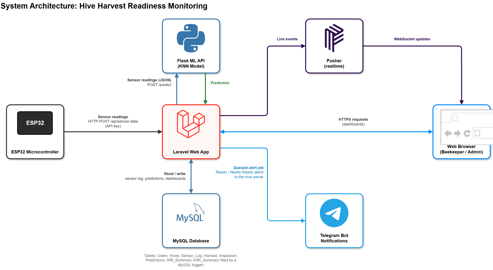
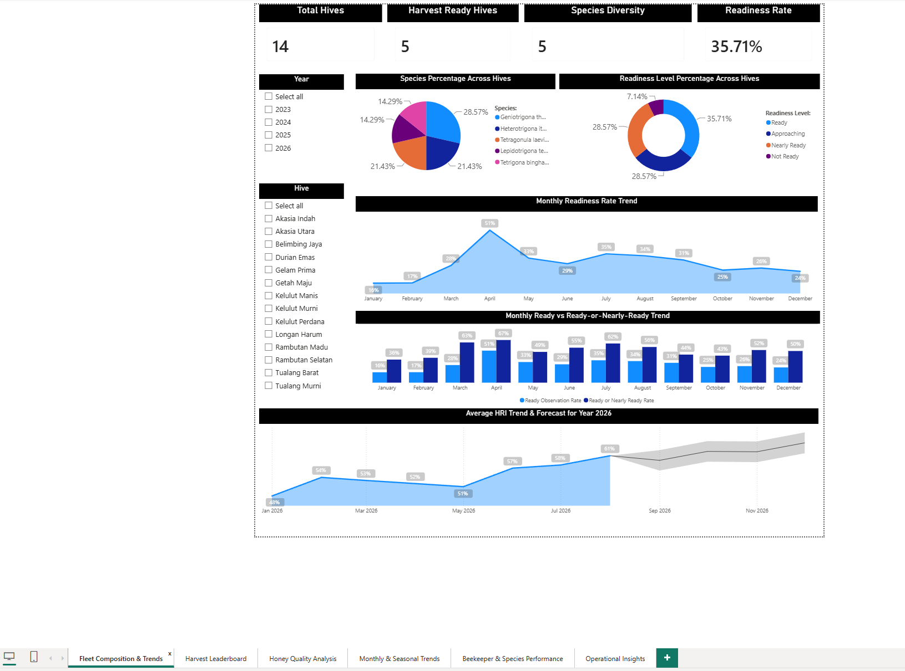
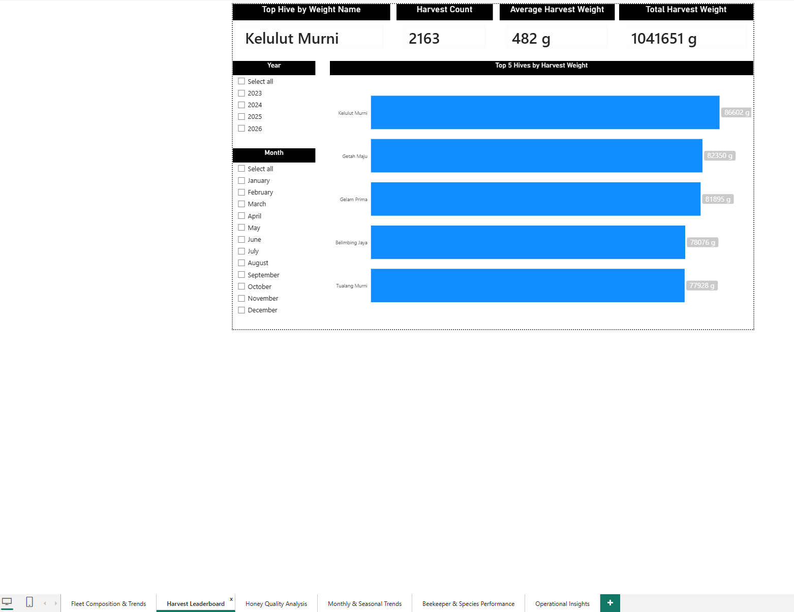
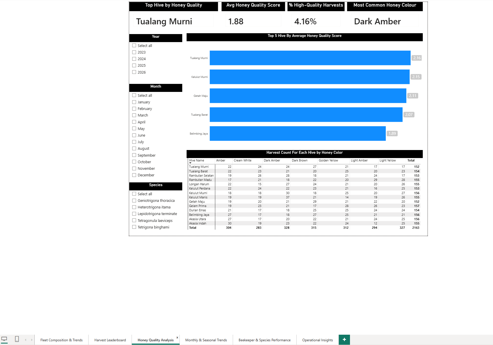
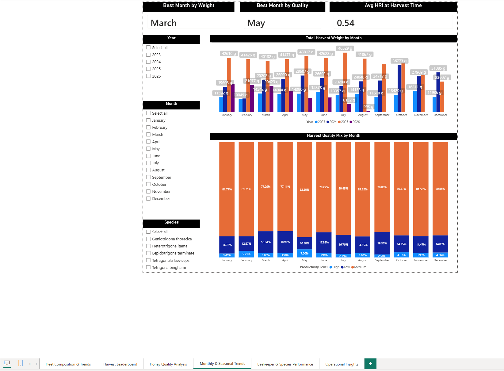
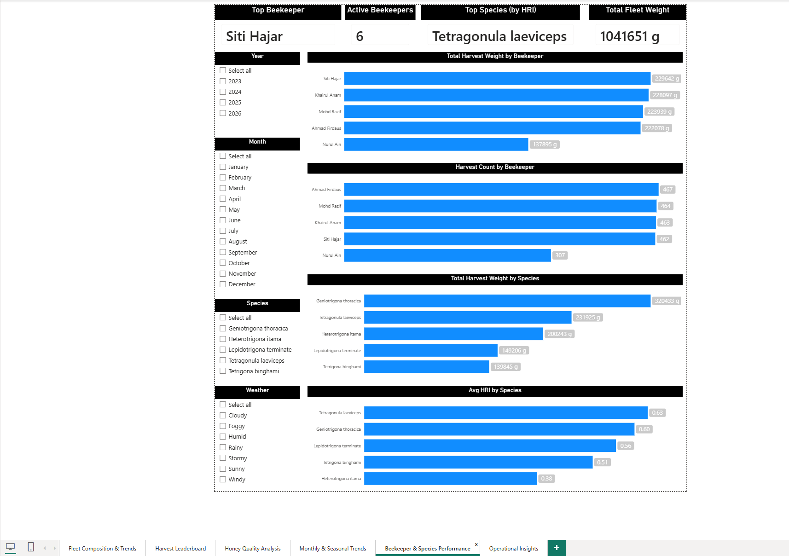
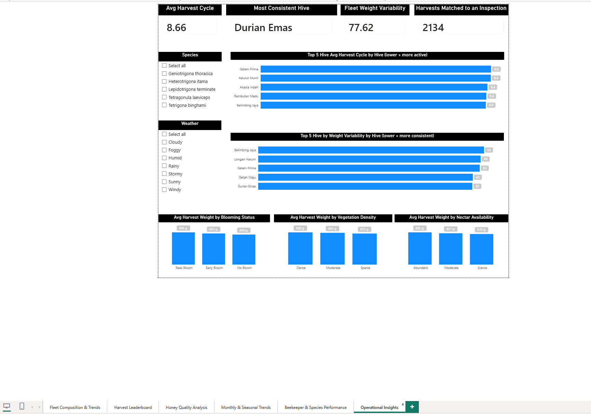
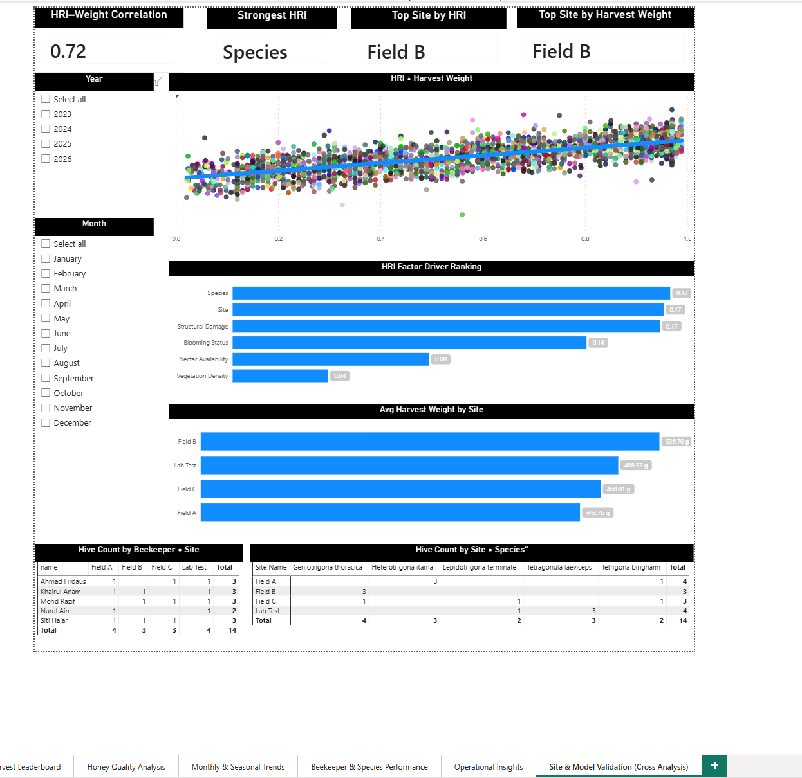

<p align="center">
  
</p>

# BuzzyHive 2.0

IoT-based harvest readiness monitoring system for kelulut (stingless bee) farming in Malaysia.

- Sensors on the hive push environmental data to the platform
- A machine learning model classifies harvest readiness
- Beekeepers manage hives, log harvests, record inspections, and track analytics from a web browser

**Live:** [buzzyhive.urban-alert.com](https://buzzyhive.urban-alert.com)

---

## Summary

- **Problem:** kelulut (stingless bee) farmers have no objective way to tell when a hive is ready to harvest.
- **Approach:** an ESP32 node posts temperature, humidity and four gas readings per hive. A KNN classifier with safety guardrails returns Not Ready, Approaching, Nearly Ready or Ready to Harvest, and the beekeeper is alerted on Telegram.
- **Delivered:** a live Laravel + React platform with 168 tests, a CI/CD pipeline to shared hosting, and a 7-page Power BI analytics report.

## 1. Features

- Real-time sensor ingestion: ESP32 posts temperature, humidity, and gas (MQ2/MQ3/MQ5/MQ135) readings via HTTP
- ML harvest readiness: Flask API runs a KNN classifier with guardrails (OOD detection, confidence-based downgrade, threshold conflict detection), returns Not Ready / Approaching / Nearly Ready / Ready to Harvest
- Realtime updates: Pusher + Laravel Echo pushes live predictions and sensor readings to the dashboard without a page refresh
- Telegram alerts: notifies the beekeeper when a hive hits "Ready to Harvest"
- Two-factor authentication: TOTP-based 2FA on all accounts
- Hive management: add/edit hives, assign beekeepers, track species and site
- Harvest records: log weight, honey color, flavor, and productivity per harvest
- Inspection logs: record hive inspections with weather conditions and flora observations
- Analytics dashboard: HRI trend charts, sensor readings, harvest history, 30-day summaries
- Reporting: per-hive HRI gauge and readiness trend over time
- Role-based access: Admin manages users and master data; Beekeepers manage their own hives
- Admin invite-only: no self-registration, admins issue invites

## 2. Architecture


*The ESP32 posts readings to Laravel (`/api/sensor-data`, API key). Laravel stores them in MySQL, gets a prediction from the Flask KNN API, broadcasts live events through Pusher to the beekeeper and admin browser, and queues a Telegram alert to the hive owner for Ready or Nearly Ready predictions.*

## 3. Limitations

- **Synthetic training data.** The model is trained on an expanded synthetic dataset anchored on thesis baselines. See [ML dataset strategy](docs/ml/ml-dataset-strategy.md) and [release criteria](docs/ml/ml-release-criteria.md).
- **Low-cost sensors.** The DHT11 and MQ-series gas sensors are hobby-grade, which is why the guardrails (out-of-distribution detection, confidence downgrade) exist.
- **Shared hosting.** The app and the Flask ML API run on Exabytes shared hosting, and `composer install` is not automated: the deploy hook returns 409 if `composer.lock` changed.
- **Known dashboard issue.** The Power BI `Active Beekeeper Count` card reads 6 instead of 5; see [DASHBOARD.md](docs/powerbi-dashboard/DASHBOARD.md#known-unresolved-issue).

## 4. Tech stack

- Backend: Laravel 13 (PHP 8.3+)
- Frontend: React 19 + TypeScript (Inertia.js)
- Styling: Tailwind CSS v4 + Radix UI
- Auth & Roles: Laravel Fortify + Spatie Permission
- Database: MySQL (production) / SQLite (tests)
- ML API: Python + scikit-learn (KNN) served via Flask REST API
- Hardware: ESP32 + DHT11 + MQ2 + MQ3 + MQ5 + MQ135
- Hosting: Exabytes shared hosting (LiteSpeed)
- CI/CD: GitHub Actions, artifact build, FTP deploy, post-deploy hook

## 5. Project structure

```
buzzyhive/
├── app/
│   ├── Http/Controllers/
│   │   ├── Admin/              # BeekeeperController, SensorDashboardController
│   │   ├── SensorController.php       # IoT HTTP POST endpoint
│   │   ├── AnalyticsController.php
│   │   └── ReportingController.php
│   ├── Services/
│   │   ├── MlPredictionService.php    # Calls Flask API, stores prediction, updates HriSummary
│   │   └── TelegramService.php
│   └── Models/                 # Hive, SensorLog, IotNode, Prediction, HriSummary, User ...
├── resources/js/pages/
│   ├── dashboard.tsx            # Beekeeper hive overview
│   ├── analytics.tsx            # HRI trend + sensor charts
│   ├── reporting.tsx            # HRI gauges + readiness trend
│   └── admin/                  # Admin dashboard, sensor monitor, user management
├── database/
│   ├── migrations/             # Full schema: master tables, core tables, junctions
│   └── seeders/                # MasterDataSeeder (auto) + demo data seeders (manual once)
├── ml/
│   ├── app.py                  # Flask REST API, POST /predict
│   ├── model.pkl               # Trained KNN model
│   ├── scaler.pkl              # Feature scaler
│   ├── train.ipynb             # Training notebook (expanded synthetic dataset)
│   └── requirements.txt
├── .github/workflows/
│   ├── deploy.yml              # tests, build, FTP upload, deploy hook
│   ├── lint.yml                # ESLint + Prettier + Pint
│   └── deploy-ml.yml           # smoke-test, upload ml/, Passenger restart
├── Dockerfile                  # Laravel image (web, worker, scheduler, migrate)
├── docker-compose.yml          # local stack: MySQL, flask-ml, Laravel roles
├── docker/                     # Caddyfile, php.ini, entrypoint.sh
├── scripts/
│   └── trigger-prod-ready-alert.ps1  # Manual diagnostic: injects a synthetic "Ready" prediction + Telegram alert
└── public/
    └── deploy-hook.php         # Post-deploy: composer install (if changed), migrate, seed, cache
```

## 6. Roles

- `admin`: full access, manages beekeepers and master data, views all hives
- `beekeeper`: own hives only, sensor dashboard, harvests, inspections

Roles are managed via Spatie Permission. Admins assign roles when inviting users.

## 7. Local setup

### 7.1 Requirements

- PHP 8.3+
- Composer
- Node.js 22+
- MySQL
- Python 3.10+ (for ML API)

### 7.2 Steps

```bash
# Clone
git clone https://github.com/tttaufiqqq/Kelulut-Hive-Harvest-Readiness-Prediction.git
cd Kelulut-Hive-Harvest-Readiness-Prediction

# PHP dependencies
composer install

# Node dependencies
npm install

# Environment
cp .env.example .env
php artisan key:generate

# Configure .env:
# DB_DATABASE, DB_USERNAME, DB_PASSWORD
# ML_URL=http://localhost:5000
# BROADCAST_CONNECTION=pusher
# PUSHER_APP_ID, PUSHER_APP_KEY, PUSHER_APP_SECRET, PUSHER_APP_CLUSTER
# VITE_PUSHER_APP_KEY, VITE_PUSHER_APP_CLUSTER, VITE_PUSHER_HOST, VITE_PUSHER_PORT, VITE_PUSHER_SCHEME
# TELEGRAM_BOT_TOKEN, TELEGRAM_CHAT_ID
# DEPLOY_SECRET (for post-deploy hook)

# Database
php artisan migrate
php artisan db:seed

# Build assets + run
npm run dev
php artisan serve
```

### 7.3 Docker

To run the whole stack in containers instead, see [Running in containers](docs/docker/docker.md). It lists the build-time and runtime settings and what the app needs from its host.

```bash
cp .env.docker.example .env.docker
docker compose up --build   # http://localhost:8080
```

### 7.4 ML API (Flask)

```bash
cd ml
pip install -r requirements.txt
python app.py
# Runs on http://localhost:5000
# POST /predict accepts { temp, humidity, mq2_value, mq3_value, mq5_value, mq135_value }
```

## 8. Hardware

The ESP32 firmware reads sensors every interval and sends a JSON POST to `/api/sensor`:

```json
{
  "device_id": "NODE-001",
  "hive_id": 1,
  "temp": 34.2,
  "humidity": 71.5,
  "mq2_value": 310,
  "mq3_value": 275,
  "mq5_value": 290,
  "mq135_value": 320
}
```

The endpoint stores the reading in `sensor_logs`, calls the Flask ML API for a prediction, stores the result in `predictions`, updates `hri_summary`, and queues a Telegram alert if readiness is "Ready to Harvest".

- Sensors: DHT11 (temp/humidity), MQ2 (smoke/LPG), MQ3 (alcohol/VOC), MQ5 (LPG/natural gas), MQ135 (air quality/CO2)
- ADC: `analogReadResolution(10)`, 0-1023 range on all MQ sensors

## 9. ML pipeline

- Task: multi-class classification, kelulut honey harvest readiness from sensor readings
- Labels: `not_ready` / `approaching` / `nearly_ready` / `ready`
- Model: K-Nearest Neighbours (KNN, k=7, distance-weighted)
- Dataset: expanded synthetic dataset anchored on Aida 'Izwani's thesis baselines (same species, same sensor types)
- Guardrails (`ml/runtime.py`): OOD detection per feature, confidence-based label downgrade, threshold conflict detection, stored alongside the raw model output for auditability
- Stack: scikit-learn to `.pkl` model + scaler, served via Flask REST API on cPanel (Passenger WSGI)
- Output per prediction: `readiness_level`, `raw_readiness_level`, `hri_value`, `raw_hri_value`, `confidence_score`, `warning_state`, `guardrail_action`, `out_of_distribution`

## 10. Analytics dashboard

A 7-page Power BI report over the live database, documented in [DASHBOARD.md](docs/powerbi-dashboard/DASHBOARD.md).

<details>
<summary>Show dashboard screenshots</summary>


*Page 1: Fleet Composition & Trends.*


*Page 2: Harvest Leaderboard.*


*Page 3: Honey Quality Analysis.*


*Page 4: Monthly & Seasonal Trends.*


*Page 5: Beekeeper & Species Performance.*


*Page 6: Operational Insights.*


*Page 7: Site & Model Validation.*

</details>

## 11. CI/CD

Push to `main` (app files only, docs and unrelated changes are ignored) triggers:

1. Lint (`lint.yml`): ESLint, Prettier, Laravel Pint, runs in parallel
2. Tests (`deploy.yml`): Pest on PHP 8.3 + 8.4 in parallel, SQLite in-memory, `Vite::fake()` (no frontend build needed), 168 tests / 842 assertions
3. Build (after tests pass): installs deps, runs `npm run build`, uploads `public/build/` as a GitHub Actions artifact
4. Deploy (after build): downloads artifact, FTPs changed files only to Exabytes, hits `deploy-hook.php`

Deploy hook (runs on server via HTTP):

- `composer install`: not automated, hook returns 409 if `composer.lock` changed, requires manual install on the server first
- `php artisan migrate --force`
- `php artisan db:seed --class=MasterDataSeeder`
- `php artisan config:cache` + `route:cache` + `view:cache`

Estimated pipeline time: 3-4 min (warm cache, code-only change)

See [CI/CD pipelines](docs/ci-cd-pipeline/cicd-pipeline.md) for the full pipeline diagrams.

## 12. Database schema

- Master / lookup: master_species, master_sites, master_sensor_thresholds, master_honey_colors, master_honey_flavors, master_weather_conditions, master_flora_types
- Core: hives, iot_nodes, sensor_logs, predictions, harvests, inspections, hri_summary
- Junction: inspection_weather, inspection_flora, sensor_log_thresholds
- Laravel system: users, cache, jobs, permissions (Spatie)
</content>

## 13. Diagnostic tool

`scripts/trigger-prod-ready-alert.ps1` is a local PowerShell script for manually verifying the Telegram alert pipeline end-to-end, without waiting for the IoT device to produce a "ready" reading.

It posts to `POST /api/internal/test-telegram-ready` with a test secret header and a chosen `mode`:

- `full_pipeline`: stores a real sensor log, calls the Flask ML API, stores the prediction, queues a Telegram alert if the model returns "ready"
- `synthetic_ready`: stores a sensor log and creates a synthetic "ready" prediction directly (bypasses ML), sends the Telegram alert synchronously without the queue

Notes:

- The endpoint is protected by an `X-Test-Secret` header matched against `services.telegram.test_secret` in `.env`
- Requires the target `hive_id` and a registered `device_id` for that hive
- The synthetic prediction is marked with `model_version: synthetic_diagnostic_ready_v1` so it's distinguishable from real ML predictions
- Run it locally against production by setting `PROD_URL`, `TEST_SECRET`, `HIVE_ID`, and `DEVICE_ID` at the top of the script

## 14. Docs index

Start with the [docs index](docs/README.md), which lists every document by topic.
